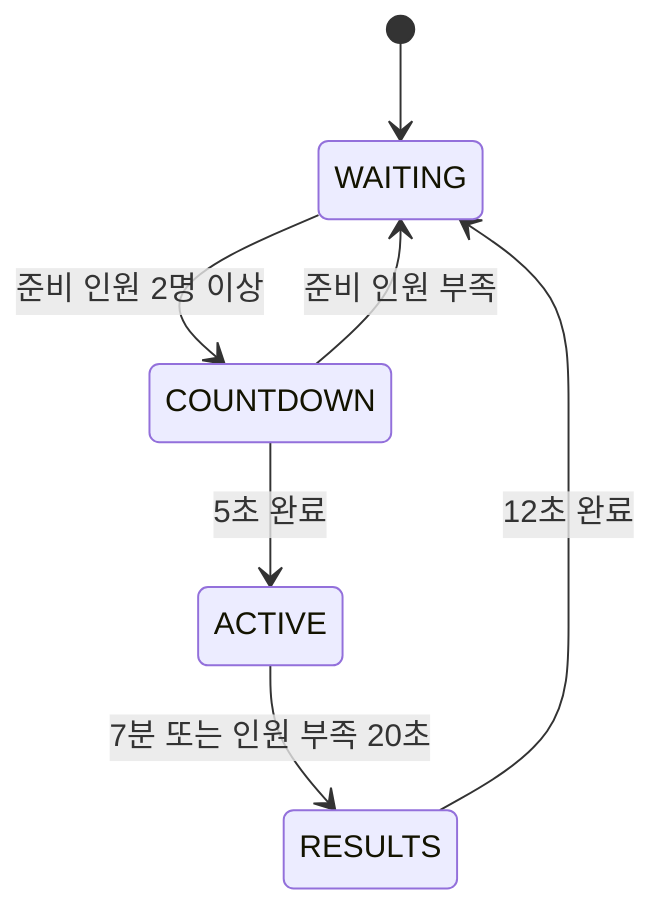

# 경기 진행 구현 — 2026-10-25 (한국 시간)

## 확정 규칙 적용

| 규칙 | 구현 |
|---|---|
| FFA 12인 | 동시 선택/출전 슬롯 12개. 미선택 Menu 플레이어는 경기에 미참가 |
| 최소 2명 | 선택 및 실제 스폰 완료, 생존한 2명이 있어야 시작 카운트다운 |
| WAITING | 선택한 플레이어가 BRICKYARD에서 자유 이동·연습. 피해/KO/데스 집계/궁극기 증가 없음 |
| COUNTDOWN | 5초. 연습은 유지하며 최소 준비 인원이 깨지면 WAITING 복귀. 회복 시 5초를 새로 시작 |
| ACTIVE | 420초. 시작 시 라운드 점수·체력·탄약·재장전·회피·상태·쿨타임·궁극기 초기화 |
| 사망/부활 | 서버 사망 시각 +4초부터 기존 스케줄러로 로드. 실제 부활 후 기존 2초 보호 |
| 중도 참가 | 빈 슬롯에서 선택하고 실제 스폰 완료 시 진행 중 경기에 참가 |
| 인원 부족 | ACTIVE의 연결된 참가자가 1명 이하이면 20초. 사망자는 여전히 참가자 수에 포함. 2명 회복 시 유예 취소 |
| 취소 | 유예 만료 시 cancelled=true인 RESULTS로 이동. 취소 결과도 12초 표시 |
| 순위 | KO 내림차순 → 데스 오름차순. 완전 동률은 공동 순위 1,1,3 방식 |
| RESULTS | 12초. 피해·신규 공격/스킬/회피/장전/궁극기·달리기 시작 차단. 선택 예약과 달리기 해제는 허용 |
| 다음 경기 | 12초 후 WAITING. 준비된 2명 이상이면 곧바로 새 5초 COUNTDOWN |

늦은 Heartbeat에서는 경기 종료 시각과 인원 유예 만료 시각 중 먼저 도달한 사유를 적용한다. 두 시각이 같으면 정상 시간 종료가 우선이다. 경계 시각에 도착한 참가/행동 요청은 만료된 경기 상태를 먼저 전환한 뒤 검증한다. 늦은 tick을 과거 시각으로 가장해 카운트다운/결과 화면을 건너뛰지 않는다.

## 개인 상태와 최초 출전

Menu는 개인 상태이며 서버 경기 phase가 아니다. 개인은 Menu → Selected → Participating/Dead로 표현한다. COUNTDOWN 이전에는 살아 있는 실제 캐릭터를 가진 Selected만 준비 인원이다.

자동 최초 LoadCharacter를 제거하고 기존 SelectCharacter를 최초 출전 요청으로 사용한다. 이 요청은 모델/생존 여부보다 먼저 스키마·빈도·등록 여부를 검증하므로 메뉴와 사망 중에도 사용할 수 있다. 최초 선택은 로드를 예약하고, 사망 중 변경은 기존 UltimateService의 pendingCharacterId로 다음 실제 부활에 적용한다. 진행 중 변경을 이유로 강제 리스폰하지 않는다.

라운드 시작은 생존·스폰 완료 플레이어의 재배치/상태 초기화 경계다. 죽거나 로드 중인 플레이어의 예약 캐릭터는 실제 부활 전까지 유지한다. 같은 라운드 내 캐릭터 변경 시 기존 궁극기 이월 상한 40은 그대로이며, 새 경기의 게이지는 0부터 시작한다.

12는 동시 출전 슬롯 상한이다. Roblox place의 MaxPlayers도 배포 설정에서 12로 지정해야 한다. 서버가 13명 이상 접속을 허용해도 13번째 미선택 사용자의 출전은 거부한다. UI 메뉴를 다시 여는 것만으로 서버 참가 자격을 해제하거나 무적 상태로 바꾸지 않는다.

## 연습과 전투 권한

- DamageService에 선택적 match policy를 추가해 피해 적용과 패링/반격 부작용보다 먼저 검사한다. ACTIVE 참가자 사이에서만 피해가 통과한다.
- 연습 중 피해 이벤트 자체가 발생하지 않으므로 피해/KO 기반 게이지와 패시브 적중을 누적하지 않는다.
- UltimateService의 시간·피해·KO 게이지 증가는 ACTIVE의 살아 있는 참가자만 허용한다.
- 구현된 궁극기는 연습에서 게이지를 올리거나 소비하지 않고 연습 발동할 수 있는 서버 정책을 제공한다. 현재 소스의 placeholder 궁극기/미구현 스킬은 여전히 거부한다. 테스트에서만 기존 allowMockUltimate를 사용한다.
- 연습 중 낙사/리셋은 물리 캐릭터 복구를 위한 Dead/4초 부활 흐름만 거친다. 점수상 데스와 처치 이벤트는 발생하지 않는다.
- ACTIVE에서는 기존 사망 후 남은 투사체의 피해 귀속을 유지한다. 퇴장한 소유자의 효과는 취소하며, 경기 경계를 넘긴 투사체는 피해를 주지 않는다.

## 경기 경계 정리와 비동기 작업

MatchScope는 라운드 epoch와 접속 식별자를 가진 서버 내부 토큰을 제공한다. 모든 상태 전환에서 이전 토큰을 무효화하고 등록한 취소 함수를 호출한다. 한 취소 함수가 오류를 내도 나머지를 정리한다.

진행 중 궁극기 종료 → 기존 캐릭터 일시 상태 정리 → 모든 투사체/설치물 폭발 없이 취소 순으로 처리한다. 종료 콜백이 만든 잔여 효과도 마지막 clearAll에서 정리한다. 기존 이동 검증 모듈은 수정하지 않고 기존 teleported API로 이동 허가를 정리한다. 클라이언트에는 기존 Correct 이벤트로 남은 회피 이동을 중단시킨다.

LoadCharacterAsync는 실제 취소 API가 없다. 취소된 로드도 반환하기 전까지 inFlight 잠금을 유지한다. 로드 ticket은 epoch·접속·attempt·1회 수락 여부를 검사한다. 맵 대기/캐릭터 자식 대기 후에도 다시 검사하며, 오래된 모델은 현재 전투 상태에 적용하지 않는다. CharacterSpawnGate의 epoch는 재접속 때 재사용하지 않는다.

최대 로드 시도 횟수를 소진하면 자동 재시도를 멈춘다. 같은 선택을 다시 요청하면 명시적 재시도를 시작할 수 있지만 기존 시간창 내 로드 상한은 유지한다. 엔진 호출이 반환하지 않은 Hung 상태에서는 새 호출을 겹치지 않는다.

현재 Sword Step1a에는 별도 지연 스킬 task.delay가 없다. **향후 5종 스킬의 지연 콜백/시전/폭탄 예약은 반드시 MatchScope 토큰과 track/guard를 연결해야 한다.** 알 수 없는 외부 task.delay를 자동 발견·취소했다고 주장하지 않는다. 기존 ForceField 감시의 모델별 연결 정리 타이머는 전투 작업이 아니므로 유지한다.

## 분리 구조

- MatchFlow: 맵·Roblox 인스턴스를 모르는 순수 서버 상태기계, 참가·유예·랭킹·최종 결과.
- MatchSession: 기존 CombatCore/CharacterController/ProjectileService/RespawnScheduler를 연결하고 권한·정리·스냅샷을 제공.
- MatchScope: 세대/접속별 취소 토큰과 향후 스킬 작업 등록.
- Main.server: 실제 플레이어/모델 로드, Remote 연결, BRICKYARD 스폰 및 서버 시간 어댑터.

별도 로비 맵은 Main의 배치/맵 준비 어댑터를 바꾸는 형태로 추가할 수 있다. MatchFlow에는 BRICKYARD 경로나 좌표가 없다.

## 현재 제한

기준 전투는 SWORD Step1a와 PAINTBALL이다. SUPERBALL/TIMEBOMB/SLINGSHOT 완성 스킬은 입력 자료에 없고 RemoteSpec도 두 캐릭터만 허용한다. 해당 스킬 로직은 구현하지 않았다. UI 디자인·클라이언트 코드도 수정하지 않았으므로 새로운 phase/countdown/rank 필드 표시에는 UI 담당 통합이 필요하다. 실제 Roblox 엔진·네트워크 동작은 Studio 미검증이다.
